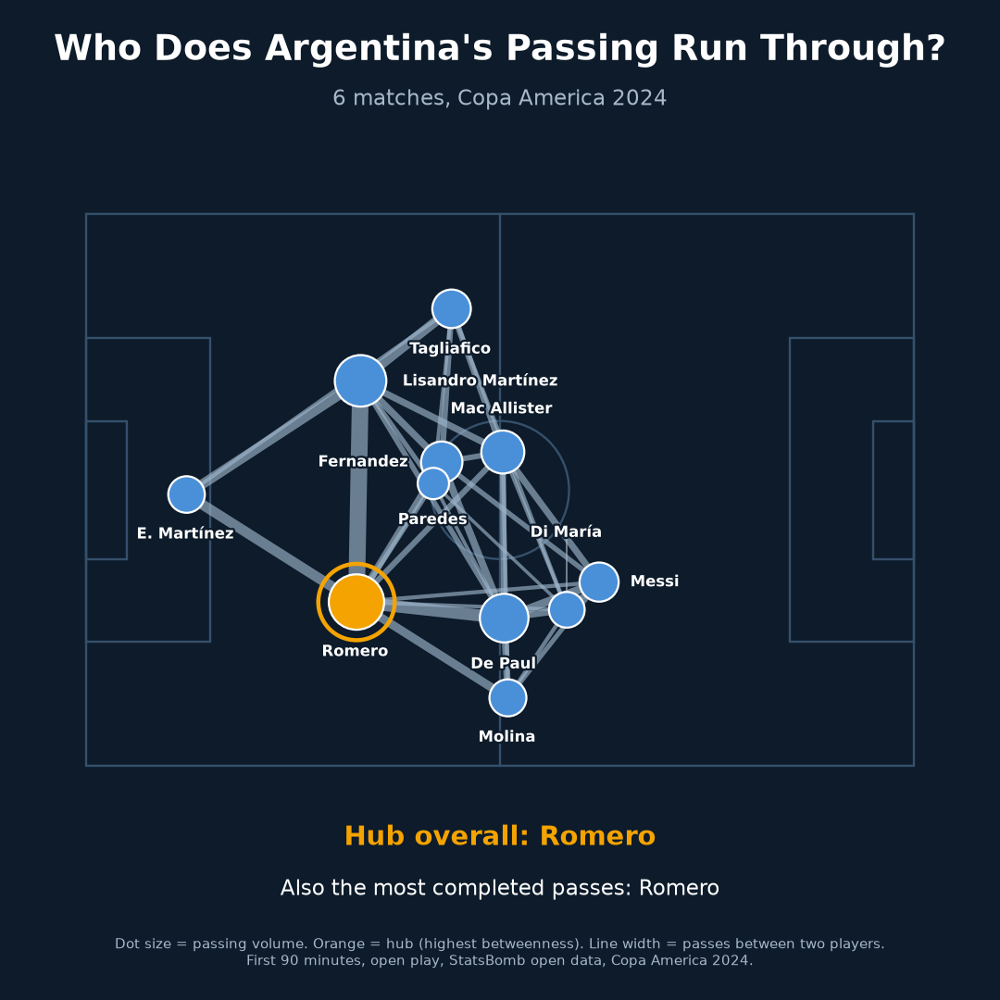
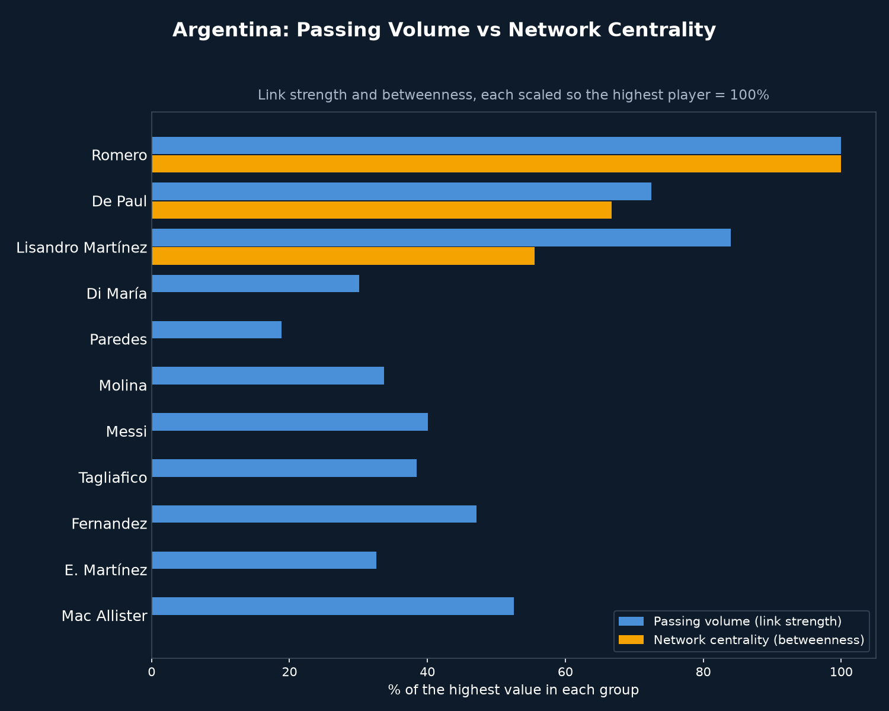

# Pass Network Analysis: Argentina at Copa America 2024

## Why
A passing total only counts volume. A network shows structure: which players the passing runs through, which links carry the buildup, and which players have no backup. This project builds Argentina's passing network across the whole tournament and measures who sits at its center, the player a pressing plan would start from.

## What it does
- Uses StatsBomb open event data for Argentina's 6 Copa America 2024 matches, first 90 minutes only
- Keeps completed open-play passes, with no corners, free kicks, goal kicks or throw-ins
- Takes the 11 players with the most completed passes as the nodes, placed at the average position they passed from
- Draws a link between two players when they connected at least 12 times, counting both directions
- Measures passing volume as total passes on a player's links, and network centrality as betweenness: how often a player sits on the shortest route between two other players, where a stronger link counts as a shorter route
- Replays the real passes in a video: the ball travels from player to player and a line is drawn at each pass

## Key findings
| Player | Completed passes | Link strength | Betweenness |
|---|---|---|---|
| Romero | 311 | 531 | 0.400 |
| De Paul | 219 | 385 | 0.267 |
| Lisandro Martínez | 288 | 446 | 0.222 |
| Mac Allister | 189 | 279 | 0.000 |
| Tagliafico | 187 | 204 | 0.000 |

Strongest links: Romero and Lisandro Martínez (142 passes), Romero and De Paul (97), Romero and the goalkeeper E. Martínez (80).

- Romero is the hub: the highest betweenness (0.40) and the most completed passes (311), and he was the hub after every one of the 6 matches
- In this data the hub and the passing leader are the same player. Volume and centrality only separate further down: De Paul has the second-highest betweenness (0.267) with fewer passes than Lisandro Martínez (219 against 288), whose betweenness is lower (0.222)
- Only 3 of the 11 players have any betweenness: Romero, De Paul and Lisandro Martínez. Argentina's passing routes funnel through those three

## Limitations
- The network describes structure, not cause and effect. Nothing here tests whether denying Romero the ball would break Argentina's buildup. The "press target" wording in the video is a scouting prompt, not a tested result
- Only 6 matches, and line-ups and formations changed between them. Each player's position is an average across all of them, so the picture blends formations
- Betweenness depends on the 12-pass cutoff for drawing a link. The network is dense, so most players score 0, which does not mean they are unimportant
- Completed passes only, first 90 minutes only, open play only. Failed passes, extra time and set pieces are excluded
- Only Argentina was analysed, so there is no comparison with other teams

## Visual

*Argentina's passing network across the tournament. Dot size shows passing volume, line width shows passes between two players, orange marks the hub*

*Link strength and betweenness for each player, each scaled so the highest player is 100%*

`pass_network_animation.mp4` in this folder replays the real passes: the ball travels between players, a line is drawn at each pass, and the network builds until the hub is clear.

## Tools
Python, pandas, numpy, networkx, matplotlib, imageio-ffmpeg, statsbombpy

## Data source
StatsBomb open data (via `statsbombpy`), Copa America 2024, competition_id 223, season_id 282
